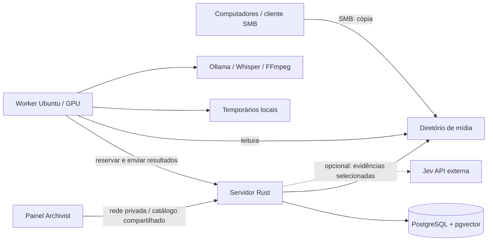

# Arquitetura proposta

> Direção de produto e plano inicial. Para o estado implementado da primeira fatia, consulte [execução](12-executar.md) e [validação](13-validacao-primeira-fatia.md).

Um projeto Rust modular com servidor e worker, sem microserviço por módulo. Não criar traits, camadas ou crates antecipadamente: uma interface só se justifica ao separar uma dependência real.

Servidor no TrueNAS via container, separado do painel administrativo; worker no Ubuntu da LAN. Implantação futura via LAN/Tailscale. Somente o servidor possui credenciais de escrita do banco.

## Fronteiras e organização futura

| Módulo | Contém | Não conhece |
| --- | --- | --- |
| domínio | Assets, importações, tarefas e invariantes | HTTP, SQL, modelos de IA |
| aplicação | Casos de uso e coordenação | Detalhes de transporte |
| adaptadores | HTTP Axum/Tokio, SQL, filesystem e IA | Regras duplicadas do domínio |
| bootstrap | Configuração e ligação das dependências | Regras de negócio |

Estrutura futura sugerida: módulos sob `src/`, executáveis `src/bin/server.rs` e `src/bin/worker.rs`; testes de integração sob `tests/`. Nenhum desses arquivos existe nesta fase documental.

DTOs HTTP separados dos tipos de domínio. Entrada validada no adaptador; invariantes garantidas no domínio. Rust coordena processos/APIs de FFmpeg, Whisper/faster-whisper e Ollama; não reimplementa inferência.

## Fila persistente

1. Servidor reserva atomicamente uma tarefa elegível no banco e entrega lease com token de tentativa e vencimento.
2. Transação termina antes da leitura de mídia ou inferência. Um trabalho de GPU por vez no worker.
3. Worker renova lease por heartbeat; usa temporários locais com limites e limpeza após falha.
4. Conclusão valida lease, geração solicitada, versão do asset e identidade do worker. Persistência do resultado e mudança de estado são atômicas.
5. Repetir a mesma conclusão retorna o resultado já registrado; tentativa expirada recebe conflito.
6. Falhas transitórias recebem tentativas limitadas e backoff. Lease expirado torna a tarefa elegível para recuperação; falha permanente requer ação explícita.

Entrega pelo menos uma vez exige idempotência; não prometer execução exatamente uma vez. Um resultado atrasado pode ser guardado como histórico, mas nunca promovido sobre uma geração mais nova ou correção humana.

## Segurança operacional

Configuração e segredos fora do Git, logs estruturados com IDs e sem conteúdo privado. Credenciais do worker não dão acesso administrativo. Somente diretórios necessários montados; originais preferencialmente somente leitura após ingestão. Não executar comandos de shell construídos com nomes de arquivos: passar argumentos separados e impor limites de tempo/recursos.
